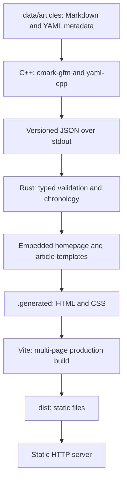

# Source architecture

## Intent

Keep content independent from the implementation. C++ understands Markdown;
Rust understands the correspondence model and generates documents; Vite
builds the static distribution. Code in one language stays with that language.
The website's public interface is generated HTML and CSS, not a live database,
a browser application, or a collection of manually maintained pages.

## Exact maintained layout

```text
source/
├── README.md
├── communications/  (headless service; see its README)
├── data/
│   ├── README.md
│   ├── articles/
│   │   ├── README.md
│   │   └── <article-slug>/
│   │       ├── article.md
│   │       ├── status.md
│   │       ├── in/
│   │       │   ├── .gitkeep
│   │       │   └── <response-slug>.md  (only when a real response exists)
│   │       └── out/
│   │           ├── .gitkeep
│   │           └── <draft-slug>.md  (public-safe unsent email drafts)
│   ├── outreach/      (article-specific research data, grouped by slug)
│   ├── organizations/  (sector/function/individual addressee JSON leaves)
│   ├── evidence/       (shared professional and historical JSON data and README)
│   ├── writing-themes.json
│   └── OFFLINE-WRITING.md  (proposal only)
├── parser/
│   ├── README.md
│   ├── CMakeLists.txt
│   └── src/
│       ├── README.md
│       └── main.cpp
├── generator/
│   ├── README.md
│   ├── Cargo.toml
│   ├── Cargo.lock
│   ├── src/
│   │   ├── README.md
│   │   └── main.rs
│   ├── assets/
│   │   ├── README.md
│   │   └── style.css
│   └── templates/
│       ├── README.md
│       ├── homepage.html
│       ├── article.html
│       ├── full-article.html
│       └── layout.html
└── web/
    ├── README.md
    ├── package.json
    ├── package-lock.json
    ├── vite.config.mjs
    ├── server.mjs
    ├── scripts/
    │   ├── README.md
    │   └── generate.mjs
    └── test/
        ├── README.md
        └── site.test.mjs
```

The root retains the README, LICENSE, Dockerfile, ignore rules and GitHub
Actions workflow. New articles belong only under data/articles/ and follow
the same article, status, in/ and out/ contract; do not add per-response
README files or example responses. Incoming responses alone feed the response
index. Outgoing drafts and shared data are not static-site inputs.
The generator reads data/articles/ and preserves /articles/<slug>/ URLs. Put data instructions in
[data/README.md](data/README.md). The two dependency lockfiles are intentional
source-controlled inputs, not compiled output.

## Data flow and responsibility



| Component | Owns | Does not own |
| --- | --- | --- |
| [communications](communications/README.md) | Headless intake, protected archive, general writing review and recovery | Static site or deferred healthcare tracking |
| [data](data/README.md) | Authored text, actual dates, status, sends, responses, shared organizations and evidence | Layout or application logic |
| [parser](parser/README.md) | YAML conversion, Markdown AST, extraction and safe renderer output | Article ordering, publication state, templates |
| [generator](generator/README.md) | Typed model, timestamp ordering, path validation, templates, JSON-LD | Reimplementing Markdown or serving HTTP |
| [web](web/README.md) | Build orchestration, Vite, static delivery, HTTP checks | Editing correspondence or interpreting its meaning |

The parser emits protocol version 1. Rust fails closed if the version or
typed schema is invalid. There is no shared-memory C++/Rust coupling or
foreign-function interface. Process exit status, JSON stdout and diagnostic
stderr are the cross-language contract. Explicit process boundaries also
keep the C++ library details out of the Rust generator.

The two page templates compose the same full-article partial and shared
layout. Templates and CSS are embedded in the Rust binary at compilation.
The article's Markdown is supplied at generation time. Vite builds all
HTML entry points, including every permanent article route.

## Find the right source file

| Change | File or guide |
| --- | --- |
| Manage the headless communication system | [Operations #6](https://github.com/grwtsk/grwtsk.com/issues/6) and [communications](communications/README.md) |
| Write or record published correspondence | [data/README.md](data/README.md) |
| Add a metadata field | [generator/src/README.md](generator/src/README.md) (typed model first, then template and tests) |
| Change Markdown handling | [parser/src/README.md](parser/src/README.md) |
| Change archive or chronology | [generator/src/main.rs](generator/src/main.rs) |
| Change HTML semantics | [generator/templates/README.md](generator/templates/README.md) |
| Change type, spacing or contrast | [generator/assets/README.md](generator/assets/README.md) |
| Change generation or delivery | [web/scripts/README.md](web/scripts/README.md) and [web/README.md](web/README.md) |
| Verify behavior | [web/test/README.md](web/test/README.md) |

## Generated files are disposable

The following directories are created by tools and ignored by Git:
`parser/build/`, `generator/target/`, `web/node_modules/`,
`web/.generated/`, `web/.generation-*/` and `web/dist/`.
All are relative to this source directory. Do not put authored data there.
A fresh checkout and the locked build should recreate them. If a build fails,
repair the source or toolchain, not the generated output.

See the [root guide](../README.md) for the daily operating instructions.
